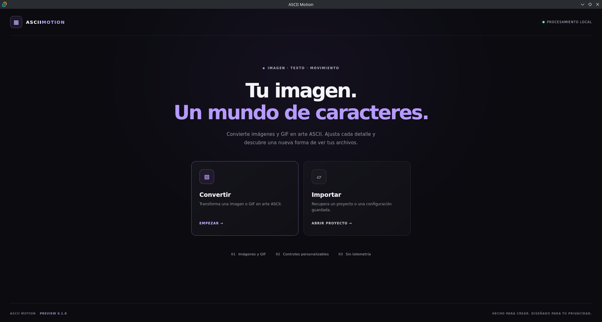
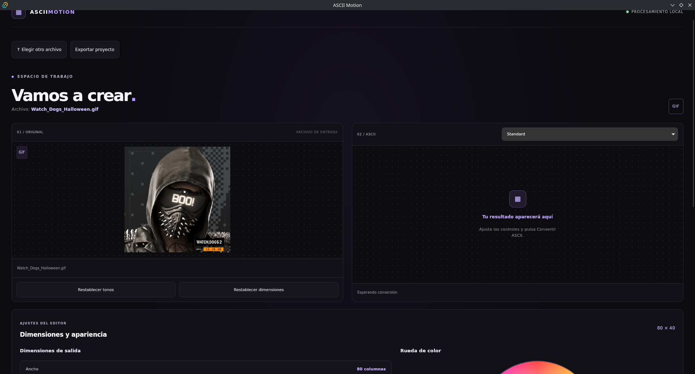
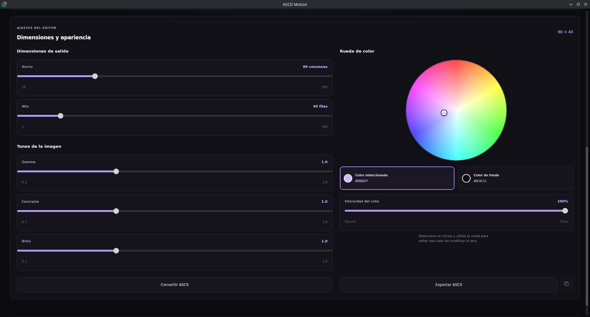

# ASCII Motion

**Turn images and animated GIFs into ASCII art.**

ASCII Motion is a desktop application that converts images and animations into customizable ASCII art. It combines a React and Tauri desktop interface with a Python conversion engine and a local FastAPI backend.

Customize dimensions, character sets, image adjustments, and colors. Preview animated GIFs, export ASCII animations, and save editable projects so you can import and modify them later.

## Screenshots

### Application Home



### Main ASCII Editor



### Export Format



## Features

### Image-to-ASCII Conversion

* Convert static images into ASCII art.
* Support for JPEG, PNG, WEBP, and BMP images.
* Convert animated GIFs into ASCII frames while preserving frame timing.
* Choose predefined character sets or create custom character sets.
* Adjust output width and height independently.
* Fine-tune brightness, contrast, gamma, and image inversion.
* Customize foreground and background colors.
* Preview converted images directly in the desktop editor.

### Editor Workspace

The editor provides a workspace for viewing the original image and its ASCII conversion.

* Preview the source image and generated ASCII art.
* Select another image or animated GIF without restarting the application.
* View converted GIF frames in the ASCII preview.
* Play, pause, and navigate through animation frames.
* Keep the conversion controls and preview together in the same workspace.

### Editor Controls and Customization

ASCII Motion offers controls for adjusting the appearance of generated ASCII art.

* Set the output width and height.
* Select predefined or custom character sets.
* Adjust brightness, contrast, and gamma.
* Change foreground and background colors independently.
* Reset dimensions and tonal adjustments.
* Preview the result after changing the conversion settings.

### Animated GIF Support

* Import animated GIF files.
* Convert GIF frames into ASCII art.
* Preserve frame order and playback durations.
* Export ASCII animations as animated GIFs.
* Embed ASCII Motion project metadata in compatible exported GIFs.

### Export and Project Management

* Export ASCII art as plain text (`.txt`).
* Export JSON data containing ASCII output, settings, colors, and animation frames.
* Export colored HTML (`.html`).
* Export ANSI-colored terminal text (`.ansi`).
* Export animated GIFs rendered from ASCII characters.
* Save editable projects as `.asciimotion.json` files.
* Import saved ASCII Motion projects.
* Restore project data from embedded GIF metadata when available.

**Keep the `.asciimotion.json` file if you want to edit a project later.** External tools may remove embedded metadata when optimizing or re-encoding GIFs, so the separate project file is the recommended backup.

### Desktop Application

* Graphical interface built with React and Tauri 2.
* Local Python backend powered by FastAPI.
* Modular image conversion engine.
* Desktop launcher for Linux.
* Source-based installation workflow for Arch Linux and Void Linux.

### Command-Line Interface

* Convert images from the terminal.
* Select character sets and conversion settings.
* Export and play ASCII animations.
* Access command-line help and available options.

## Technologies

| Technology | Purpose                                    |
| ---------- | ------------------------------------------ |
| Python     | Core conversion engine                     |
| Pillow     | Image processing and GIF handling          |
| NumPy      | Numerical image operations                 |
| FastAPI    | Local conversion API                       |
| Uvicorn    | Local API server                           |
| React      | Desktop user interface                     |
| Vite       | Frontend development and production builds |
| Tauri 2    | Native desktop application                 |
| Rust       | Desktop application runtime                |
| pytest     | Automated backend tests                    |

## Installation on Linux

ASCII Motion includes a source-based installer intended for Arch Linux and Void Linux. It checks system dependencies, prepares the Python environment, builds the frontend and desktop application, and creates a desktop launcher.

The installer compiles the application on the target computer. Prebuilt AUR, XBPS, and AppImage packages are not currently provided by this installer.

### Requirements

* Arch Linux or Void Linux.
* An internet connection.
* Sufficient disk space to download dependencies and compile the application.
* Permission to install system dependencies when required.
* A supported graphical Linux desktop environment.

### Install from Source

Clone the repository:

```bash
git clone https://github.com/vicente-arriagada-lost/ASCII_Motion.git
cd ASCII_Motion
```

Run the installer:

```bash
chmod +x scripts/install-linux.sh
./scripts/install-linux.sh
```

The installer displays its planned operations and asks for confirmation before proceeding. Enter `Y` to continue or `N` to cancel.

Run the installer as your regular user, not with `sudo`. It requests elevated privileges when system package installation requires them.

**Compatibility status:** the source-based installation has been tested on a Void Linux development machine. A clean Arch Linux installation still requires independent validation.

### Launch the Desktop Application

After a successful installation, open ASCII Motion from your desktop application's menu.

You can also launch it from a terminal:

```bash
~/.local/bin/ascii-motion-launcher
```

The launcher starts the local backend and opens the desktop application.

## Development Setup

### 1. Create a Python Environment

```bash
python3 -m venv .venv
source .venv/bin/activate
```

Install the project and its development dependencies:

```bash
python -m pip install --upgrade pip
python -m pip install -e ".[dev]"
```

Check the command-line interface:

```bash
ascii-motion --help
```

### 2. Install Frontend Dependencies

```bash
cd frontend
npm install
```

### 3. Start the Development Environment

```bash
npm run dev:tauri
```

This command starts the local API and Vite development server together. It is intended for development rather than as the production desktop launcher.

## Command-Line Usage

Activate the Python virtual environment if needed before running CLI commands.

### Show Help

```bash
ascii-motion --help
```

### List Character Sets

```bash
ascii-motion --list-charsets
```

### Convert an Image

```bash
ascii-motion image.png
```

### Set the Output Width

```bash
ascii-motion image.png --width 120
```

### Select a Character Set

```bash
ascii-motion image.png --charset dense
```

### Adjust Contrast and Brightness

```bash
ascii-motion image.png --contrast 1.2 --brightness 1.1
```

### Adjust Gamma and Normalize Contrast

```bash
ascii-motion image.png --gamma 1.2 --normalize-contrast
```

### Invert the Output

```bash
ascii-motion image.png --invert
```

### Save the Output to a File

```bash
ascii-motion image.png --output result.txt
```

### Play an Animated GIF

```bash
ascii-motion animation.gif --play
```

### Export an ASCII Animation

```bash
ascii-motion animation.gif --export-animation ascii_animation.txt
```

### Play an Exported ASCII Animation

```bash
ascii-motion --play-file ascii_animation.txt
```

Run `ascii-motion --help` to see the options supported by your installed CLI version.

## Using Animated ASCII with Fastfetch

ASCII Motion can export animated GIFs rendered from ASCII characters. Fastfetch can display these files as animated logos when the selected logo type and Fastfetch build support the required animation features.

For example, on a compatible setup:

```bash
fastfetch \
  --logo-type kitty \
  --logo "$HOME/Pictures/ASCII-Motion/my-animation.gif" \
  --logo-width 50 \
  --logo-height 25 \
  --logo-animation-frame 0
```

Replace the example path with the location of your exported GIF.

The GIF contains rendered pixels representing ASCII characters, rather than live terminal text. The animation can be displayed as an animated image, but the individual characters are not editable terminal text.

Keep the associated `.asciimotion.json` project if you want to modify the animation later.

## Project Files and Exports

### `.asciimotion.json` — Editable Project

The project file stores the original image, conversion settings, colors, and generated ASCII output, including animation frames and their durations.

Import it into ASCII Motion to restore the editing session and continue working on the project.

### Animated GIF

The exported GIF contains the rendered ASCII animation and can include embedded ASCII Motion project metadata.

Importing a GIF created by ASCII Motion can restore its project when the embedded metadata is still available.

A regular GIF without project metadata can still be imported as an animation, but its original editor settings may not be recoverable.

## Testing and Code Quality

Run the backend test suite:

```bash
PYTHONPATH=src .venv/bin/python -m pytest -q
```

Run frontend linting:

```bash
cd frontend
npm run lint
```

Build the frontend:

```bash
npm run build
```

Build the Tauri desktop application:

```bash
npm run tauri -- build --no-bundle
```

Run Ruff checks when Ruff is installed:

```bash
ruff check src tests
ruff format --check src tests
```

## Project Structure

```text
ASCII_Motion/
├── frontend/
│   ├── src/                 # React user interface
│   └── src-tauri/           # Tauri desktop application
├── src/
│   └── ascii_motion/
│       ├── api/             # Local FastAPI service
│       ├── cli/             # Command-line interface
│       ├── core/            # Conversion and image processing
│       ├── models/          # Settings and frame models
│       └── renderers/       # ASCII output rendering
├── tests/                   # Automated tests
├── scripts/                 # Installation scripts
├── pyproject.toml
└── README.md
```

The conversion engine is modular and can be used independently of the graphical interface.

## Current Scope and Limitations

* The conversion engine focuses on static images and animated GIFs.
* Video conversion is not part of the current scope.
* The project does not rely on FFmpeg or OpenCV.
* The Linux installer builds the application on the target computer.
* Prebuilt AUR, XBPS, and AppImage packages are not currently provided by the installer.
* Installation on clean systems should be tested before the installer is recommended for general use across distributions.

## Roadmap

* Improve installation across Linux distributions.
* Publish prebuilt packages for supported distributions.
* Automate release builds and distribution artifacts.
* Improve export options and project compatibility.
* Optimize conversion performance and error handling.
* Expand documentation and add more examples.

## License

ASCII Motion is distributed under the **GNU General Public License v3.0 only (`GPL-3.0-only`)**. See [`LICENSE`](LICENSE) for the complete license text.

The GPL permits use, modification, redistribution, and commercial distribution subject to its terms. Redistributed versions must comply with the applicable license and source-code requirements.

Third-party dependencies may have separate licenses. Preserve their notices and review their terms when redistributing the application.
